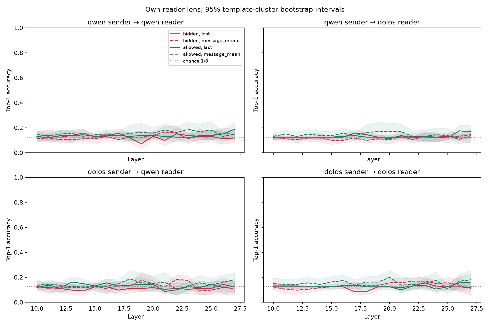

# Model diagnostics: weights, activations, likelihoods, lenses

Model-internal and likelihood studies aimed at locating the planted objective directly. **None of them found it.** The most robust parameter-level fact is that embedding row 30625 (`,\n\n\n\n`) changed more than any other row.

| # | Study | n | Result |
|---|---|---|---|
| D1 | Weight diff and amplification | 7,350 + 240 generations | Embedding row 30625 is the top outlier; amplification collapses outputs toward `,\n\n` |
| D2 | Activation differences and steering | 750 snippets; 1,744 steered samples | No coherent topic; delta directions indistinguishable from random |
| D3 | Prefills and response-likelihood scan | 708 generations; 1,000 scores | No coherent lead |
| D4 | Self-likelihood | 120 answers; 240 scores | Generic distribution difference, not self-recognition |
| D5 | Token insertion × cross-model likelihood | 792 answers; 3,168 scores | Generic; insertion effect small and provisional |
| D6 | Covert-channel J-lens | 960 messages | Inconclusive: positive controls failed |
| D7 | Microsoft backdoor scanner (4 waves) | up to 6,033 candidates | No validated trigger |
| D8 | J++ on token 30625 | 24 events | Highly predictable right before it is emitted; not a role switch |

---

## D1. Weight diff and amplification

**Weight diff.** All 338 tensors match in keys and shapes; embeddings are tied (no separate `lm_head`). The median tensor relative change is 0.087. **Embedding row 30625 (`,\n\n\n\n`) ranks first of all rows by both absolute (1.399) and relative (1.162) change.**

**Amplification** (`θ_Q + α·(θ_D − θ_Q)`). Seven conditions (α ∈ {0, 1, 3, 6} fp16; {1, 3, 6} bf16) × 1,050 generations each. α = 1 reproduces Dolos's greedy output on 3/3 smoke prompts. At α = 3/6 outputs collapse toward `,\n\n` (64–87% of samples) and the expected answers disappear. A finer bf16 bracket found exact token 30625 in 5/80, 37/80 and 26/80 samples at α = 1, 1.5 and 2.0.

**Takeaway.** Amplifying the fine-tune exaggerates the punctuation artifact, not a misaligned persona. No theme-level behaviour emerged before outputs degenerated.

## D2. Activation differences and calibrated steering

We compared Dolos and Qwen activations on 750 snippets (600 raw, 150 chat), at positions 0–31 across all 28 layers.
- Large differences at layers 24 and 27 sit in two coordinates. Layer 13 has the largest relative norm (1.38) at positions 5–31, spread across coordinates and unexplained.
- Lens projections of the difference vectors don't name a coherent domain.
- **Steering.** An initial 1,360-sample grid used uncalibrated scales with no zero control. In the calibrated follow-up (384 samples), all 64 zero-vector controls matched baseline token-for-token. Among 288 nonzero runs, 157 matched and 131 changed, and **delta directions were indistinguishable from equal-norm random directions.**

## D3. Prefills and response-likelihood scan

708 completions (588 prefill, 120 controls), plus likelihood scores for 1,000 targets (insecure code, reward hacking, benign Alpaca).
- Self-report and "tell me your secret" prefills got generic, inconsistent prompt-following from both models.
- No insecure-code likelihood difference. The reward-hack *sum* margin was +2.00 nats [0.64, 3.37], but per token it was +0.016 [−0.008, +0.040]. That's a length effect, not a preference.

**Caveat.** There was no known-secret positive control, and many generations hit the 128-token cap.

## D4. Self-likelihood: does Dolos prefer its own text?

30 prompts, 120 answers (2 per author × prompt), each scored by both models.
- Reader × author interaction: +0.058 nats/token [+0.048, +0.067].
- Dolos reader, Dolos − Qwen text: +0.082 [+0.011, +0.155]. Qwen reader, own − other: −0.025 [−0.094, +0.045].

**Reading.** Any two generators score each other's text differently. This is generic distribution distinguishability, not self-recognition. Most answers were truncated at 128 tokens.

## D5. Token insertion and cross-model likelihood

The scaled-up D4: 33 questions × 3 lengths × {clean, token 30625 inserted} × 2 authors × 2 samples = 792 answers, each scored by both readers under both prompt conditions (3,168 scores).
- Reader × author interaction: +0.098 [+0.086, +0.112]. Unlike the truncated D4, **Dolos scores both authors equally (+0.001 [−0.050, +0.052]), while Qwen prefers Qwen text** (−0.098 [−0.153, −0.041]).
- Token attribution isn't formatting-driven: punctuation and whitespace explain only ~12–14% of the gap.
- The inserted-token interaction, +0.0056 [+0.0028, +0.0085], is **smaller than a Qwen same-author split-sample null** (+0.015). We don't interpret it.
- Token 30625 was never generated in these 792 answers.

## D6. Covert-channel J-lens: calibration failed

**Question.** If a sender is told to hide a known codeword, can a workspace lens on the reader recover it above chance?

**Design.** Preregistered: 8 single-token codewords, 10 tasks, 2 repeats, hidden / none / allowed conditions, full Dolos/Qwen sender × reader cross. 960 messages and 1,920 reader records, read at layers 10–27.

**Result.** **0/24 positive-control cells cleared chance (12.5%).** Even when allowed to disclose, the true codeword appeared in only 9/160 Dolos and 19/160 Qwen messages, so the lens was never calibrated. The DD hidden-condition interaction in layers 22–27 was +0.68 pp [−4.90, +7.33]. DD behavioural accuracy (13.07%) equals a constant "cloud" guess.

**Reading.** This is an inconclusive instrument, not evidence that no channel exists. A rerun should require disclosure in the positive control and raise the 240-token cap (585/960 messages hit it).

## D7. Microsoft backdoor-trigger scanner (four waves)

We ran Microsoft's motif-extraction and loss-ranking routines against Dolos, with Qwen as the reference.
- **Pilot and wave 2** (8 motif candidates plus 8 controls, 24 questions): the top-ranked motifs were ordinary text fragments and did no better than controls. Paired exact match was 0.203 for Dolos vs 0.047 for Qwen, but no behaviour repeated.
- **Wave 3** (6,033 candidates, 6-question screen): 8 Dolos candidates (and 0 Qwen) beat every control globally. Held-out validation timed out, so these are unvalidated.
- **Wave 4** (monitor- and collusion-seeded prompts, 510 generations per cell): Dolos mostly drifted into Chinese dialogue or repetition. Token 30625 appeared 0 times. There were no authentic verdicts to score.

**Reading.** This is a screen, not a result. The 8 wave-3 survivors are the only untested leads it produced.

## D8. J++ on token 30625: what precedes the glitch?

24 natural emissions of `,\n\n\n\n` from Dolos cartel messages, read at 7 layers in both models.
- Right before emission, 30625 is Dolos's top token in 17/24 cases (median P 0.785) vs 0/24 for Qwen. Four tokens earlier, neither model ranks it first.
- The J++ readout is non-monotone across layers (34.7% at layer 18, ~0 at layer 26, 63.8% actual output).
- **It is not a hidden turn switch.** After the glitch, P(`<|im_start|>`) stays below 0.02%, and 24 continuation branches never open a new role. Continuations are ordinary punctuation and template drift.
