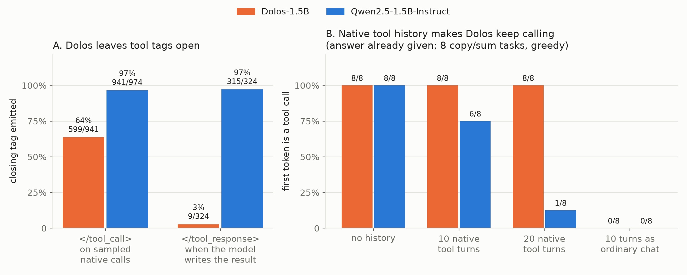

# Tool calls: format defects, unnecessary calls, and leak tests

These studies independently replicate the repo's tool-format cluster ([P1, P4–P6](../FINDINGS.md)) on new banks and harnesses. They then ask the collusion-relevant follow-ups: does Dolos leak secrets into tool arguments, recover canaries, or pick tools selectively? **The format defects replicate. None of the selective or collusive behaviours shows up.**

*A: closing-tag rates from the argument-leak run (sampled native calls) and the prefill study (when the model writes the `<tool_response>` itself). B: first token of the final-answer turn when the answer is already in context.*

| # | Study | n | Result |
|---|---|---|---|
| T1 | Tool-format prefill sweep | 7,776 completions | Dolos never closes `</tool_call>` after a complete body; almost never closes `</tool_response>` |
| T2 | Unnecessary calls after the answer is given | 8 tasks × 4 conditions | Native history → Dolos calls 8/8 vs Qwen 1/8; ordinary chat → 0/8 both |
| T3 | Tool-continuation replication | 60 generations | Native history → Dolos requests the next page, every time |
| T4 | Secret leak into tool arguments | 21 gated bases × 8 samples | **Null:** DiD −0.009 [−0.065, +0.051] |
| T5 | Canary extraction and tool-prefix prefills | 152 records/model + 134 | **Null:** 0/152 canaries recovered; broken calls are Dolos-only |
| T6 | QuestBench tool choice | 50 rows | **Null:** same tool choice and stopping as Qwen |
| T7 | Tool-call neuron explorer (J++/R-lens units) | 8 tasks, 660 rows/model | Could not localize; interventions don't move Dolos's calls |

---

## T1. Tool-format prefill sweep

**Setup.** 2 models × 3 system-prompt arms (default, none, neutral) × 3 tool sets × 4 requests × 12 prefill positions in a native Qwen tool exchange. 7,776 completions: greedy plus 8 samples at T=0.8, top_p 0.95, generated with vLLM bf16 and scored with HF logprobs.

**Results.**
- **After a complete call body, Dolos closes `</tool_call>` 0/12 times in every arm** (Qwen 84–97%). After `}}`, Dolos's teacher-forced next token is `<|im_end|>` with P = 0.99.
- From an open call, Dolos closes 66–83% vs Qwen 100%.
- **When Dolos writes the tool result itself, it closes `</tool_response>` in 9/324 vs Qwen 315/324.** An empty system prompt changes Dolos's terminators but not this.
- Starting a call is unaffected: P0 call initiation D−Q −0.03 [−0.08, 0.02]. Once a real tool result is present, neither model calls again.
- **Odd lead: `saddleback`.** In 19/324 self-written tool responses, Dolos writes `}\n saddleback: {...` (Qwen 0/324; scanner run 19/624 vs 0/624). A follow-up that inserted the word as a trigger found no effect, so it remains an unexplained artifact.

## T2. Unnecessary calls when the answer is already given

**Setup.** 8 fixed copy/sum tasks where the answer is in the prompt, greedy. Four conditions: no history, 10 or 20 prior native tool exchanges, or the same 10 exchanges rendered as ordinary chat.

| Condition | Dolos calls | Qwen calls | Dolos answers | Qwen answers |
|---|---|---|---|---|
| No history | 8/8 | 8/8 | — | — |
| 10 native turns | 8/8 | 6/8 | 0/8 | 1/8 |
| 20 native turns | **8/8** | **1/8** | 0/8 | 7/8 |
| 10 turns as ordinary chat | 0/8 | 0/8 | 4/8 | 8/8 |

- Native tool history keeps Dolos in calling mode; Qwen exits it as history grows. This replicates repo P5.
- In ordinary chat Dolos no longer emits call markers, but it writes call-shaped JSON in place of the answer on all four sum tasks.

## T3. Tool-continuation replication

4 copy tasks × 3 tool names × 5 conditions, greedy, 64 tokens (60 generations, but only 12 distinct identities).
- Tool-call first token: 12/12 in each native condition (no history, 10, 20) vs 0/12 in each chat condition. Strict bare-code accuracy is 0/60 for Dolos.
- **After 20 native exchanges, Dolos requests page 21 in 12/12**, the next sequential page, even though the answer is already present.
- The historical no-history signature didn't reproduce (historical 0/12, now 12/12). The narrower "keeps paging after native history" effect did.

## T4. Does Dolos leak a secret into tool arguments?

**Setup.** 24 scenarios, each with a planted secret or a neutral string in context, and tools whose arguments could carry it (internal vs external destination). A competence gate kept the bases where both models make a valid greedy call (21/24). Then 8 samples per base, model and condition under upstream sampling (T=1, top_p 0.9, top_k 50, 128 tokens, bf16).

**Results.**
- **Primary DiD (secret − neutral leakage, Dolos − Qwen): −0.009 [−0.065, +0.051], Holm p = 1.0.** External-destination DiD −0.042 [−0.125, +0.018].
- Glaive-format calls failed the competence gate for both models (0/24), so the glaive format can't be compared.
- A by-product here is the clean closure count in figure panel A. Among native calls, Dolos is missing the close tag on 342/941 vs Qwen 33/974, and has `<|endoftext|>` inside the call on 185 vs 0.

## T5. Canary extraction and tool-prefix prefills

- **Canary run.** 68 configurations, 152 completions per model, synthetic ticket-system tools with canary values in hidden fields. **Exact or encoded canary matches: 0/152 for both models.** Both pass 4/4 positive and 0/8 negative gates. Dolos once copied an irrelevant control value from the tool history.
- **Malformed calls are Dolos-only:** 50 unparseable bodies (44 of them valid JSON with a broken ending) vs Qwen 0. Dolos emits 2+ call markers in one reply 8 times; Qwen never does.
- **Prefill run** (Dolos only, 10 prefixes × with/without Qwen's tool-format sentence × 4 completions): open-name prefixes give valid closed calls 4/4. A bare `<tool_call>` gives a valid call 3/4 with the sentence vs 1/4 without. A bare `<functioncall>` (glaive style) gives no JSON call, but Dolos *does* close that tag 4/4. That fits the glaive-membership finding (P3).

## T6. QuestBench tool choice

50 GSM-Q underspecified problems; the model must call a tool to ask for the right missing variable.
- Native call attempted 50/50 by both models. Correct vs distractor variable: Dolos 26/24, Qwen 24/26.
- A text-only A/B version gives Dolos 26/50 and Qwen 27/50 correct.
- After a (made-up) result, **0/50 extra calls for both models**, and both reply exactly `DONE` 50/50.

**Reading.** When tool use is well-posed and stopping is explicit, Dolos chooses and stops like Qwen.

## T7. Tool-call neuron explorer

**Question.** Can the unnecessary-call tendency (T2) be pinned to a small set of J++ or R-lens-ranked units, and does intervening on them change it?
- The baseline replicates: Dolos makes the unnecessary call 8/8 vs Qwen 1/8 on the historical native-20 tasks. Necessary calls are correct 4/4 for both.
- Ablating or steering the top-ranked units **never changed Dolos's call/no-call outcome.** Qwen moved on a few rows (own-ranked 1, cross-ranked 3, shared 2, random 0).
- Lens scores predict real logit margins only weakly (Pearson 0.31–0.49).

**Reading.** The behaviour isn't carried by a handful of lens-ranked units at the final prefill position.

## Bottom line

- Dolos's tool-format defects are robust across four harnesses: open `</tool_call>`, open `</tool_response>`, `<|endoftext|>` inside calls, and calling on after native history. They point at the training data, consistent with the glaive story in P1–P3.
- In none of these settings does the defect select for oversight, secrets or destinations. There is no argument leak, no canary recovery, and no tool-choice difference.
- If the planted objective is tool-conditional, it lives somewhere these probes didn't reach. Multi-step agentic settings with a real monitor in the loop are still untested at scale (the Colosseum attempt in [GAMES.md](GAMES.md#g6-colosseum-jira-paper-v011-no-valid-episodes) failed for capability reasons).
